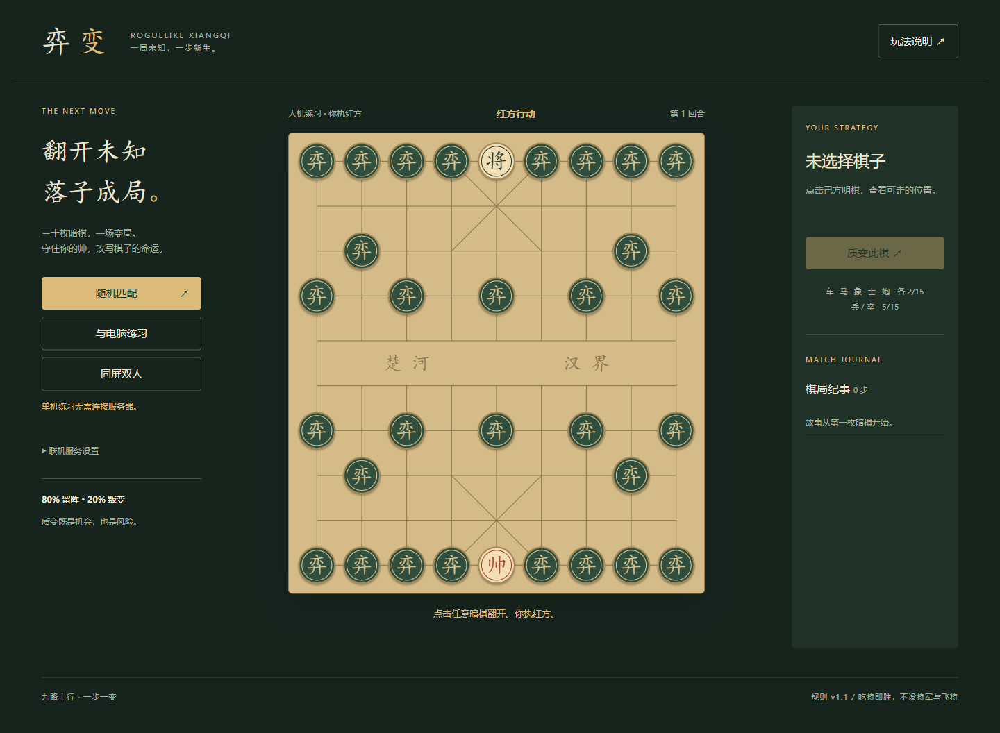

# 弈变 · 肉鸽象棋

依据《开发文档.docx》中「肉鸽象棋规则最终完整版 v1.1」开发的浏览器游戏，适配手机和电脑，支持人机练习、同屏双人和跨设备随机匹配。

游戏入口：[打开弈变](https://chen33-dot.github.io/chess/)。两位玩家分别点击「随机匹配」即可配对，网页默认连接 `https://yibian-match.onrender.com`。免费实例休眠后首次连接可能需要约一分钟。



## 本机运行

安装 Node.js 18+（建议 22），在项目目录执行：

```sh
npm start
```

浏览器打开 http://localhost:8080 。项目没有第三方运行依赖，不需要先执行 `npm install`。

人机练习和同屏双人在浏览器内运行。若要测试本机匹配服务，在网页「联机服务设置」中将地址设为 `http://localhost:8080`，再用两个独立浏览器或隐私窗口进行匹配。否则网页仍使用默认的公网匹配服务。

## 操作与规则

点击任意暗棋即可翻开并换手；点击己方明棋，再点击合法落点移动；选中己方非将帅明棋后，可点击「质变此棋」。人机模式由玩家执红方。切换到人机或同屏双人会开始新局。

双方翻开和质变时，棋子周围先出现白色光圈，1 秒后显示结果；只显示对方移动的绿色圆圈和指向落点的绿色箭头，保留 3 秒，自己的移动不显示轨迹。人机模式只显示电脑轨迹，联机模式只显示对手轨迹，同屏双人以当前行动方为视角。吃将后在棋盘上展示胜方 5 秒，再随机重置棋盘；联机模式回到待匹配状态，可点击「随机匹配」开始下一局。

- 棋盘为 9×10 个交叉点。将帅固定明置，30 枚非将身份混合随机排列到传统初始棋位。
- 翻开不会转移归属。暗棋占位、阻挡、可作炮架，但不可吃、移动或质变。
- 将帅九宫内直走一格；士全盘斜一格；象可过河但保留塞象眼；马保留蹩马腿；车不越子；炮隔一个炮架吃明子；兵卒上下左右一格。
- 质变先决定归属（80% 保留、20% 叛变），再决定兵种：车马象士炮各 2/15，兵卒 5/15。将帅不参与质变。
- 不设将军、应将和飞将，允许照面和送将。吃将立即胜，其次无合法动作判负，最后检查和棋。
- 连续 240 步只有非吃子移动、总计 600 步、同一真实局面且同一行棋方第三次出现，均判和。

电脑使用本地棋步评分算法，只读取公开棋局，不知道暗棋身份，不调用大模型或消耗 AI token。联机模式由服务器验证行动、保存暗棋身份并决定随机结果。对局保存在服务器内存中，重启后不会保留。

## 项目文件

| 文件或目录 | 功能 |
|---|---|
| `web/index.html` | 网页结构与玩法说明 |
| `web/style.css` | 界面样式与手机适配 |
| `web/app.js` | 棋盘绘制、玩家交互、模式切换和联机请求 |
| `web/engine.js` | 浏览器与服务器共用的游戏规则，以及人机算法 |
| `web/config.js` | 默认匹配服务地址 |
| `server/index.js` | HTTP 服务器入口、静态文件、跨域与请求限制 |
| `server/service.js` | 会话、匹配队列、对局管理和断线处理 |
| `tests/game.test.js` | 规则与联机接口测试 |
| `tests/browser.mjs` | 双浏览器对局和移动端布局测试 |
| `package.json` | Node.js 项目配置与运行命令 |
| `.github/workflows/pages.yml` | 测试并发布 GitHub Pages |
| `render.yaml` | Render 匹配服务部署配置 |
| `scripts/github_pages.py` | 可选的 Pages 管理脚本，仅维护部署时需要 Python |
| `开发文档.docx` | 原始规则文档 |
| `DEPLOY.md` | 本机运行及部署说明 |
| `REFERENCES.md` | 传统象棋规则与开源参考 |
| `web-preview.png`、`mobile-preview.png` | 电脑和手机浏览器界面预览 |

## 验证与部署

执行 `npm test` 检查规则、信息隐藏、匹配、掉线处理和 HTTP 接口。可选的浏览器测试见 [DEPLOY.md](DEPLOY.md)。

前端由 GitHub Pages 托管，匹配服务由 Render 托管。仓库提供自动部署配置；fork 或重新部署时请按 [部署指南](DEPLOY.md) 设置自己的服务地址。
