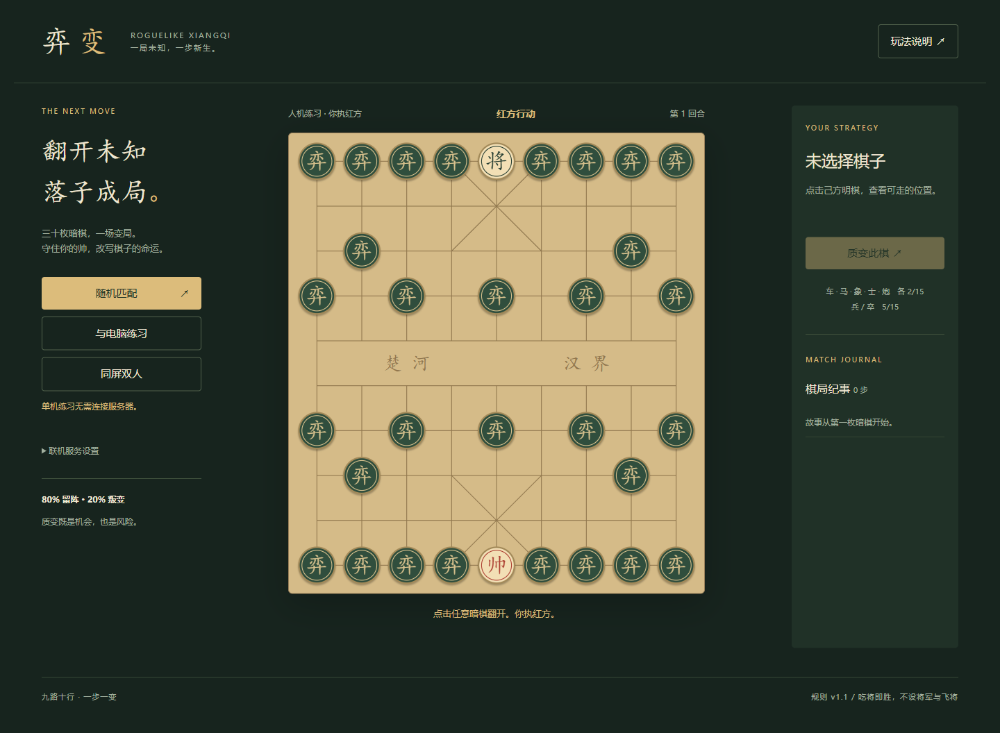

# 弈变 · 肉鸽象棋

## 网页版 v2

新增适配手机与电脑的浏览器版，支持人机练习、同屏双人和跨设备随机匹配。运行 `npm start` 后打开 http://localhost:8080 。前端位于 `web/`，可部署 GitHub Pages；联机服务位于 `server/`，无第三方运行依赖。

部署步骤见 [DEPLOY.md](DEPLOY.md)。已提供 GitHub Pages 工作流与 Render 免费服务 Blueprint；联机上线仍需部署匹配服务并填写 `web/config.js` 的服务地址。浏览器不能仅凭 GitHub Pages 完成公共随机匹配。

以下为保留的桌面版说明。

依据同目录《开发文档.docx》的「肉鸽象棋规则最终完整版 v1.1」开发的本地桌面游戏。原始文档保留不变。Python 3.9+，使用标准库 Tkinter，无网络服务、无第三方运行依赖。

## 启动

双击 `启动游戏.bat`，或在本目录执行 `python main.py`。Windows 安装 Python 时需包含 Tcl/Tk（官方安装器默认包含）。当前电脑已验证 Python 与 Tk 8.6 可用。

默认人机模式：玩家红方，电脑黑方；左侧可切换本地双人，保留当前棋局。点击暗棋直接翻开；点击己方明棋后再点击落点移动；选中非将帅明棋后点击质变。点击「玩法说明」查看完整操作规则。支持方向键、Enter、空格、M 和 Esc。

## 规则实现

- 9×10 交叉点棋盘，河界与双方九宫；将帅固定明置，30 枚非将身份混合随机排列到传统初始棋位。
- 任意暗棋均可翻开，翻开不会转移归属。未翻开身份不出现在界面、日志或 AI 输入中。
- 将帅九宫内直走一格；士全盘斜一格；象可过河但堵眼；马蹩腿；车不越子；炮隔一个炮架吃明子；兵卒四向一格。
- 背面棋子占位、阻挡、可作炮架，但不可吃、移动或质变。
- 质变先判归属（80% 保留、20% 叛变），再按独立的固定 15 枚权重抽兵种。将帅不参与质变。
- 不设将军、应将、飞将，允许照面和送将。吃将立即胜，其次无动作判负，最后检查三项和棋。
- 连续 240 个半回合只有非吃子移动、总计 600 个半回合、同一真实局面同一行棋方第三次出现，均判和。计数包含隐藏身份，不包含未来随机数状态。`Game` 构造参数可调整回合阈值。
- 结束后锁定行动，不提供悔棋或跳过，以免撤回已知暗棋或重抽质变结果。

AI 使用独立公开视图，只进行轻量吃子收益、对方下一步威胁和接近敌将评估；不是高强度搜索引擎。随机排列和质变使用系统随机源，AI 在后台线程计算。桌面单机的内部状态不是防本地调试作弊的安全边界。

## 文件与验证

- `engine.py`：纯规则、状态、随机动作、终局与 AI。
- `main.py`：Tkinter 桌面界面，棋盘矢量绘制，无外部图片或字体下载。
- `test_engine.py`：规则边界、随机结果、终局及公开视图测试。
- `test_ui.py`：窗口创建和实际交互冒烟测试。
- `REFERENCES.md`：传统规则研究与开源参考。

执行 `python -m unittest -v` 运行测试。当前版本不含联机、存档或关卡成长系统；开发文档定义的 roguelike 元素为随机暗棋与质变，未额外改变对局规则。
